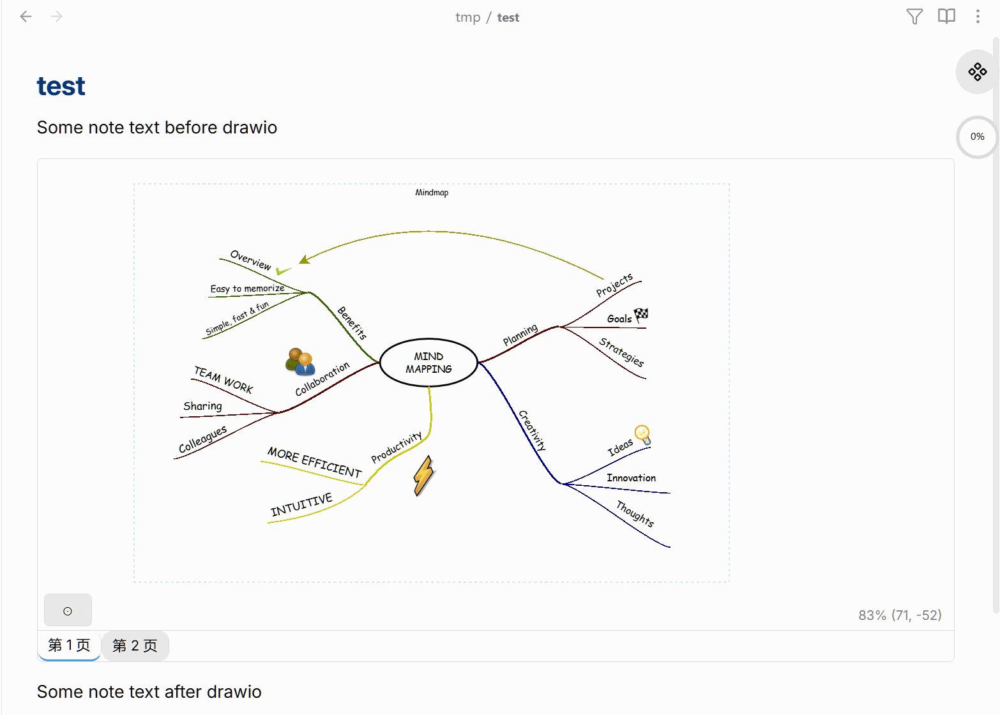

<div align="center">



<p>
  <b>🔍 缩放 &nbsp;·&nbsp; 🖱️ 平移 &nbsp;·&nbsp; 📄 多页 &nbsp;·&nbsp; 🔗 图形链接 &nbsp;·&nbsp; 🔎 放大镜 &nbsp;·&nbsp; 📦 三方图形库 &nbsp;·&nbsp; 🌙 深色模式</b>
</p>

<p>
  <a href="https://github.com/SdKay/obsidian-rich-view/releases/latest">
    
  </a>
  <a href="https://github.com/SdKay/obsidian-rich-view/releases">
    
  </a>
  <a href="LICENSE">
    
  </a>
  <a href="https://obsidian.md/plugins?id=rich-view">
    
  </a>
</p>

<p>
  <a href="README.md">English</a> ·
  <a href="#使用方法">使用方法</a> ·
  <a href="#三方图形库">三方图形库</a> ·
  <a href="#操作方式">操作方式</a> ·
  <a href="#设置项">设置项</a> ·
  <a href="#安装">安装</a>
</p>

<p>
  
  <br/><sub>关注微信公众号，获取更多 Obsidian 插件与工具</sub>
</p>

<p>
  🧩 顺便看看我的另一个插件 <b>Rich Table</b> —— 支持合并单元格、类型化列、样式与双向链接的交互式表格：
  <a href="https://github.com/SdKay/obsidian-rich-table">GitHub</a> ·
  <a href="obsidian://show-plugin?id=rich-table">去商店中安装</a>
</p>

</div>

在 Obsidian 笔记中内嵌渲染各类富文件格式——支持流畅缩放平移、多页标签、图形链接，以及完整的三方图形库支持。目前支持 [draw.io](https://www.drawio.com/) `.drawio` 和 Visio `.vsdx` 文件，未来会支持更多格式（PPT、Word、CAD 等）。

---

## 使用方法

将图表文件放在 vault 任意位置，用围栏 `rich-view` 代码块嵌入：

````markdown
```rich-view
file=my-diagram.drawio
```
````

其他字段都是显式的 `key=value`，用 `|` 分隔，顺序任意：

````markdown
```rich-view
file=my-diagram.drawio|page=my_page|height=600|zoom=80|offset=190,34
```
````

| 参数 | 格式 | 示例 | 说明 |
|------|------|------|------|
| `file` | `key=value` | `file=my-diagram.drawio` | 必填，vault 相对路径或裸文件名 |
| `page` | `key=value` | `page=my_page` | 按**精确名称**指定显示哪一页，默认第一页 |
| `page-index` | `key=value` | `page-index=2` | 按 1-based 位置指定页面；同时写了 `page=` 时忽略此项 |
| `height` | `key=value` | `height=600` | 查看器高度（像素），默认 400 |
| `zoom` | `key=value` | `zoom=80` | 初始缩放百分比，默认自动适应 |
| `offset` | `key=value` | `offset=190,34` | 初始平移位置，默认居中 |

只有 `file=` 是必填的，其他字段都可以省略。

---

## 三方图形库

如果你的图表用了扩展图形库（AWS、Azure、GCP、Cisco、电气符号、IBM 等），插件会自动检测，并在首次打开时顶部弹出**下载横幅**。

点击 **Download**，缺失的图形库会从 draw.io 官方仓库下载到本地，后续所有图表直接复用，无需再次下载。横幅上还有 **Settings** 快捷入口，方便手动管理。

进入**设置 → Rich View → Shape Libraries** 可以：
- 按分类浏览并下载官方图形库
- 点击 **Auto-detect from vault** 扫描 vault 中所有 `.drawio` 文件，一键检测所需图形库
- 设置**自定义图形库目录**，放入自己的图形文件后自动加载

---

## 操作方式

| 操作 | 效果 |
|------|------|
| **滚轮** | 缩放 |
| **拖拽** | 平移 |
| **双指捏合** | 捏合缩放（触屏/移动端） |
| **双击** | 重置到初始视图 |
| **拖拽底边** | 调整查看器高度 |
| **↗** | 用系统默认程序打开文件 |
| **⛶** | 按当前查看器尺寸自动适配 |
| **🔍** | 开关放大镜 |
| **⊙** | 将当前视图写回代码块 |
| **页签** | 切换页面（多页图表） |

**小技巧：** 平移缩放到想要的视图，点击 ⊙，代码块自动更新，下次打开即恢复该视图。一旦保存了具体的缩放/偏移，双击就会恢复到*那个保存的视图*而不是重新自动适配——点 ⛶ 才能重新自动适配（比如调整查看器高度之后），满意了再点 ⊙ 保存。

### 图形链接

将鼠标悬停在任意图形上，出现 **✎** 按钮。点击可以为图形添加或修改链接（vault 笔记或外部 URL）。点击图形本身可跳转链接（具体按键取决于「点击行为」设置）。

### 放大镜

点击 **🔍** 可以在不改变当前缩放/平移的情况下查看细节。一个圆形放大镜会跟随鼠标，放大倍数固定；**+ / -** 调整放大镜范围大小。滚轮仍然正常缩放主视图。按 **Esc** 或点击其他任意位置退出。

---

## 深色模式

Obsidian 切换深色主题时，查看器自动适配，无需任何配置。

---

## 设置项

| 设置 | 说明 |
|------|------|
| **缩放修饰键** | 普通滚轮或 Ctrl+滚轮缩放 |
| **点击行为** | 单击还是 Ctrl+单击跟随图形链接 |
| **自定义图形库目录** | 存放自定义图形文件的 vault 目录 |
| **Shape Libraries** | 下载官方图形库，支持从 vault 自动检测 |

---

## 安装

### 社区插件市场（推荐）

1. **设置 → 社区插件 → 浏览**
2. 搜索 **Rich View** → 安装 → 启用

### 手动安装

从[最新 Release](https://github.com/SdKay/obsidian-rich-view/releases/latest) 下载 `main.js`、`manifest.json`、`styles.css`，复制到 `<vault>/.obsidian/plugins/rich-view/`。

---

## 已知限制

- draw.io 的部分表格或特殊图形可能无法完整渲染。
- 不支持 `![[file.drawio]]` 嵌入语法，请使用代码块方式。
- 在实时预览模式下退出代码块编辑器时，页面可能轻微上移（正在调查中）。

---

## Star 历史

[](https://star-history.com/#SdKay/obsidian-rich-view&Date)

---

## 许可证

[MIT](LICENSE) © 2026 [sdking.xing](https://github.com/SdKay)
